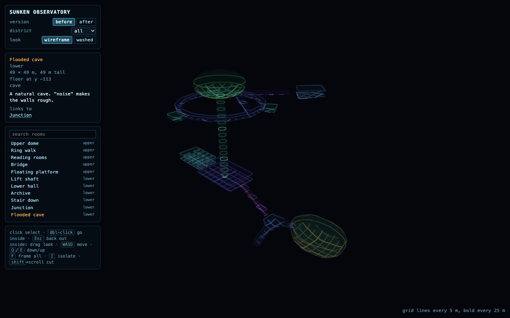

# holomap

A 3D map viewer for games with tangled, layered spaces: caves,
underground halls, floating platforms, shafts and tunnels. Think of
the 3D maps in Metroid Prime. You describe rooms as simple shapes in
a JSON file, and holomap shows them as a see-through holographic map
that you can fly around and step inside.

**[Try the demo](https://naelissegal.github.io/holomap-viewer/)**



## What it does

- **See-through rooms** with metre grid lines, in two looks:
  *wireframe* and *washed*.
- **Go inside a room** (double-click). You look around from inside,
  move with WASD, and you can't fall out through the walls. Walk
  through a doorway or a shaft and you're in the next room.
- **Room cards** with size, floor height, tags, notes and links to
  other rooms.
- **Districts, search, isolate** (I) and a **section cut**
  (shift + scroll) to slice the map from the top.
- **Versions**: switch between several files of the same place
  (before / after, or different drafts).
- **Live editing**: save the JSON and the map updates by itself.
  Only the rooms you changed are rebuilt.
- Works with big worlds. Each room gets its own detail level, the
  shapes are built in the background, and the page only draws when
  something changes.

## Use it with your own maps

You need Python 3 (no installs).

```sh
python3 holomap.py path/to/your/maps
```

This opens the viewer in your browser, showing the `.json` maps in
that folder. On Windows use `py holomap.py ...`. Add `--port 4031`
to pick a different port.

You can also drag a map file onto the page to look at it.

See [FORMAT.md](FORMAT.md) for how to write a map. The demo in
`examples/demo/` uses every kind of shape.

## Controls

| do this              | to |
| -------------------- | -- |
| drag / scroll        | turn and zoom |
| click                | select a room |
| double-click         | go inside |
| Esc                  | back out |
| WASD, Q / E          | move, down / up (inside) |
| shift                | move faster |
| F                    | frame the whole map |
| I                    | isolate the selected room |
| shift + scroll       | section cut |

## Licence

MIT. See [LICENSE](LICENSE).
